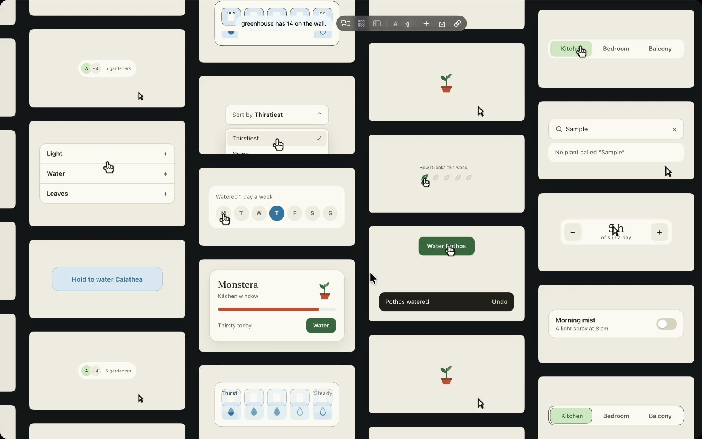

# Moodboard

A Mac app that plays every component of a Next.js project live on an endless wall. Open a tile to use the component and tune it with dials. Each dial rewrites a literal in your source, and editing the source redraws the tile.

[](https://moodboard.shariqmalik.dev/)

Website: <https://moodboard.shariqmalik.dev/>

Moodboard runs only on your Mac. It has no account and sends nothing anywhere. Paper and Claude Code are optional.

## Install

You need macOS 26 or later. To connect projects, you also need Node 20.19 or newer.

The prebuilt app is for Apple silicon. This command downloads the latest release into `~/Applications` and opens it. Set `MOODBOARD_DIR` to install somewhere else.

```bash
curl -fsSL https://raw.githubusercontent.com/shariqmalik10/moodboard/main/scripts/install.sh | sh
```

You can also download `Moodboard.zip` from the [latest release](https://github.com/shariqmalik10/moodboard/releases/latest). The app isn't notarized, so macOS blocks a copy downloaded in a browser. Try to open it once, then click **Open Anyway** in **System Settings > Privacy & Security**.

### Build from source

Building needs Xcode and Node 20.19 or newer, and works on Intel Macs too.

```bash
git clone https://github.com/shariqmalik10/moodboard.git
```

```bash
cd moodboard && scripts/build.sh
```

The script builds the web parts and the app, copies the app to `~/Applications`, and opens it. `scripts/build.sh --zip` writes `build/Moodboard.zip` instead, which is how a release is made.

## First launch

A welcome sheet offers three optional steps. **Help > Welcome to Moodboard** opens it again.

1. **Node.** It checks for Node 20.19 or newer.
2. **Something for the wall.** **Try the Greenhouse demo** copies a small Next.js app to `~/Moodboard Demo` and connects it. **Connect a project…** picks one of yours.
3. **Claude Code.** **Add to Claude Code** registers the app as an MCP server for your user. It runs this command:

   ```bash
   claude mcp add -s user moodboard -- ~/Applications/Moodboard.app/Contents/MacOS/Moodboard --mcp
   ```

## Connect a Next.js project

Do one of these:

- Drag the project's folder from Finder onto the wall.
- Choose **File > Connect Next.js Project…** (⇧⌘O), or click the link button in the bar and then **Connect a project…**.
- Open Claude Code in the project's folder and ask it to "connect this project to moodboard", or type `/mcp__moodboard__connect`. Claude Code calls `connect_project` on the folder it's working in. The app opens behind your other windows if it's closed. The reply says how many components joined, which didn't and why, and what to fix.

The folder can be the app, any folder inside it, or a monorepo. A monorepo with one Next.js app connects that app. With several, the app asks which one. The project needs its packages installed. If something is missing, such as the packages or a new enough Node, the app says what to do. Connecting again is safe and restarts a project that stopped.

macOS may ask whether Moodboard can read your Documents, Desktop or Downloads folder. Choose **Allow**. If you chose **Don't Allow**, turn Moodboard on in **System Settings > Privacy & Security > Files and Folders**.

What happens next:

- The app starts a Vite server for the project on this Mac. It runs each exported client component on its own, inside every `*Provider` your `layout.tsx` files wrap around the page. The server's cache lives in the app's data folder, not in the project.
- The first tiles arrive within a few seconds. The first connection can take up to half a minute while Vite prepares the packages. A component that throws or draws nothing stays off the wall, and the link popover lists it under **can't stand alone** with the reason.
- Saving a file redraws its tile, usually in under 200 ms. A new file adds a tile and a deleted file removes it. While a file has a syntax error, its tile keeps its last good look.
- The demo loop presses real buttons, so the page refuses every request except reads, and links and forms go nowhere.

To disconnect, open the link popover, click **…** beside the project and choose **Disconnect**. Your files stay as they are.

### Dials edit your source

An open project tile has two kinds of dials:

- **Sample props** are values made up from the component's TypeScript types. They never touch your files.
- Every other dial is a literal in your code, such as a Tailwind class, an inline style, or a value in a stylesheet. Moving it rewrites that literal while you drag, and the tile redraws through the project's own hot reload.

A dial writes only when you move it. A dial in a stylesheet changes every component that uses that rule, and the line under the panel names each file the dials edit. If the file changes in your editor while you tune, your editor wins and the panel reloads.

## Use the wall

- Scroll or drag to move. Pinch or ⌘-scroll to zoom. Tab and Shift-Tab walk the tiles.
- Click a tile to open it. The loop stops and the component is yours to click and type in. **Start over** resets it, and **Watch it play** plays the loop once. Esc closes it.
- Drop a picture or a film on the wall, or click **+**, to add it.
- ⌘1, ⌘2 and ⌘3 switch between Wall, Grid and List. Grid shows every item in an equal cell. List shows one component with its dials beside it. The bar also filters by project.
- ⌘F searches. The chips under the search filter by **To build**, **Notes**, **Paper changed** and **Built**.

## From Paper to code

1. Design a component in Paper. The `design_in_paper` prompt starts this from Claude Code.
2. Import the frame with the import button in the bar, or ask Claude Code. An import only reads from Paper.
3. Open the tile and tune it. Hold **Hold to compare** or Option to see the design without your tune. When the frame changes in Paper, the panel offers **Update**, and ⇧⌘U updates every changed frame.
4. Write what you want in the note and press **Send** (⌘Return). Send runs `claude -p` in the folder you choose, with permission to edit files there. When it succeeds, the component reads **Built** and the note clears. The **…** menu has **Copy Brief for Claude Code** and **Mark as Built** for other ways of building it.

**Send** uses the `claude` command, which signs in separately from the Claude desktop app. Run `claude auth login` once.

While the app is in front, it reads each imported frame from Paper every 20 seconds to compare it. It never writes to Paper.

Grid captions and List rows show where each component stands:

| Mark | Meaning |
| --- | --- |
| **Paper changed** | The frame in Paper no longer matches the design here. |
| **Changed since built** | You tuned or updated it after it was built. |
| **N tuned** | You moved N dials and it has never been built. |
| **Built** | The code was built from exactly this tune and design. |
| **N written** | A project component's dials wrote N changes to the source. |

## Claude Code tools and prompts

The app answers through `Moodboard --mcp`. If the wall is closed, the first call opens it. Tools that take an `id` use the open component when you leave it out.

| Tool | What it does |
| --- | --- |
| `status` | The component count, the open component, and what Paper has open and selected. |
| `list_components` | Every component with its id, title, project, whether it's on the wall, and its build state and note. |
| `get_component` | A component's brief: the note, the tuned values, the JSX with the tune applied, and the CSS. |
| `open_component` | Brings the window forward and opens a component. |
| `set_dials` | Sets dial values. On a project component it writes the source file. |
| `set_note` | Writes a component's note. |
| `mark_built` | Records that a component is built from its current tune, and clears its note. |
| `import_from_paper` | Imports the selected frames, or a frame by name. Importing again updates it. |
| `connect_project` | Connects the project at `path`, or the folder Claude Code is working in, and reports what joined. |
| `list_projects` | Connected projects, what's on the wall, what isn't and why. |
| `disconnect_project` | Disconnects a project and removes its tiles. |

| Prompt | What it asks for |
| --- | --- |
| `connect` | Connect this project and say what joined. |
| `implement_component` | Build the open component, as tuned, into this repository. |
| `build_tuned` | Build every tuned component that isn't in the code yet. |
| `apply_notes` | Work through the notes on the wall. |
| `design_in_paper` | Design a component in Paper, then put it on the wall to tune. |

## Data

Everything lives in `~/Library/Application Support/Moodboard/`: the board, dial values, notes, Paper imports, pictures, cached stills, connected projects and the Vite cache. Delete `welcomed` to see the welcome sheet again.

To remove Moodboard, delete the app and that folder, then run `claude mcp remove moodboard -s user` if you added it to Claude Code.

## Known limits

- The prebuilt app is for Apple silicon and signed only ad hoc, so macOS may ask for folder access again after an update. Build from source on an Intel Mac.
- Async server components, fonts from `next/font/local`, and unsaved editor changes don't show as they do in the real app. Google fonts load only online.
- Paper must be open to import, update or notice a change. Images and fonts from Paper load online.
- At most 12 tiles run live at once. Past that, tiles show stills. Each live tile is a web process of about 40 MB, so the Wall uses about 1 GB with a project connected. Grid and List use about half that.
- Animation stops while the window is hidden, minimised or on another Space.

## Work on the code

| Path | Contents |
| --- | --- |
| `native/Moodboard/` | The Swift app: `App`, `Board`, `Canvas`, `Focus`, `Paper`, `MCP`, `Projects`. |
| `sync/` | The project server: finding components, sample props, reading and writing literals, and the shims that run Next.js code under Vite. |
| `src/paper/` | Turns Paper JSX into a running component and writes the brief. |
| `src/stage/` | The page that runs one component and plays its loop. |
| `src/demos/` | Hand-written components bundled into the app. The public build has none. `src/demos/types.ts` describes a row. |
| `demo/` | Greenhouse, the demo project. |
| `docs/` | The website, served by GitHub Pages. |
| `tools/video/` | Records and cuts the demo film. See [`tools/video/README.md`](tools/video/README.md). |
| `index.html`, `src/board/` | The older browser wall. The app doesn't use it. `npm run dev` serves it. |

After you change `src/`, `sync/` or `demo/`, run `npm run build` and build the app again. After you add a Swift file, run `xcodegen generate --spec native/project.yml`. A Debug build keeps its data in `~/Library/Application Support/Moodboard Debug`.

Check your work from the project root:

```bash
npm run typecheck
```

```bash
npm test
```

```bash
xcodebuild test -project native/Moodboard.xcodeproj -scheme Moodboard -derivedDataPath native/build -destination 'platform=macOS'
```

## License

MIT. See [LICENSE](LICENSE).
